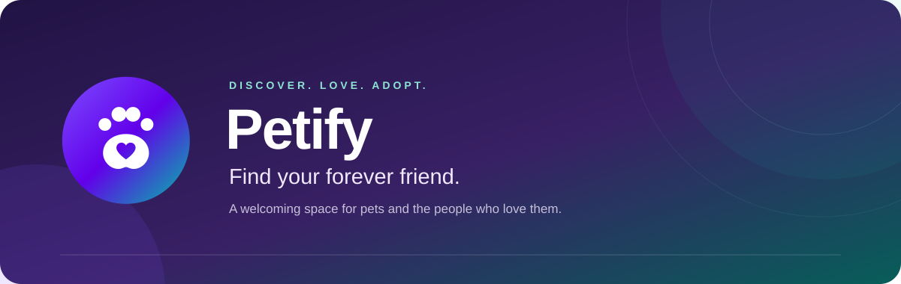

 

A little discovery. A lot of love. Your next companion starts here.

**[Overview](#-overview) · [Features](#-features) · [Design](#-designed-to-feel-at-home) · [Built with](#-built-with) · [GitHub](https://github.com/AliHesham2/Petify)**

The Google Play download link will be added here when available.

<!-- GOOGLE PLAY: When the listing is ready, replace the Coming soon image with a linked download badge using the confirmed store URL. -->

 

## 🐾 Overview

**Petify** is a native Android pet adoption app that brings discovery, pet profiles, and adoption requests into one welcoming experience. Explore different categories, find a pet that catches your eye, and keep your favorites close.

Built around a purple and teal identity, Petify combines a friendly interface with thoughtful touches for everyday browsing.

## ✨ Features

| | What you can do |
| :--- | :--- |
| 🐶 **Discover pets** | Browse featured companions and categories for dogs, cats, birds, fish, and more. |
| 🔎 **Find your match** | Search pet listings and narrow your results with category and tag filters. |
| 🐾 **Explore profiles** | Get to know each pet through its breed, age, gender, description, and listed adoption fee. |
| 💜 **Save favorites** | Mark pets you love while browsing listings and profiles. |
| 📝 **Manage requests** | Create adoption requests, review your saved requests, and cancel them when needed. |
| ➕ **Add a pet** | Create a listing with pet details, a category, and a featured status. |
| 👤 **Make it yours** | Create a local account, keep your session, and choose your language and appearance. |

## 🎨 Designed to feel at home

- **Light, dark, or system** — choose your preferred appearance, with animated color transitions.
- **English and Arabic** — switch languages in the app, with right-to-left layouts for Arabic.
- **Room to explore** — adaptive navigation and side-by-side pet browsing on larger screens.
- **Details that connect** — an animated splash screen, rounded cards, and a consistent Material 3 interface.

## 📱 Availability

**Google Play · Coming soon**

Supports **Android 9 (API 28) and above**.

The current version uses an on-device pet catalog with sample listings. Accounts, favorites, added pets, and adoption requests are stored locally; requests are not yet delivered to shelters or other users.

## 🛠 Built with

**Kotlin · Jetpack Compose · Material 3 · Hilt · Room · DataStore · Paging 3**

Compose screens, ViewModels, and repositories keep the interface and app data organized, with local persistence for the core experience.

---

<b>Every forever friendship starts with a hello. 🐾</b>

